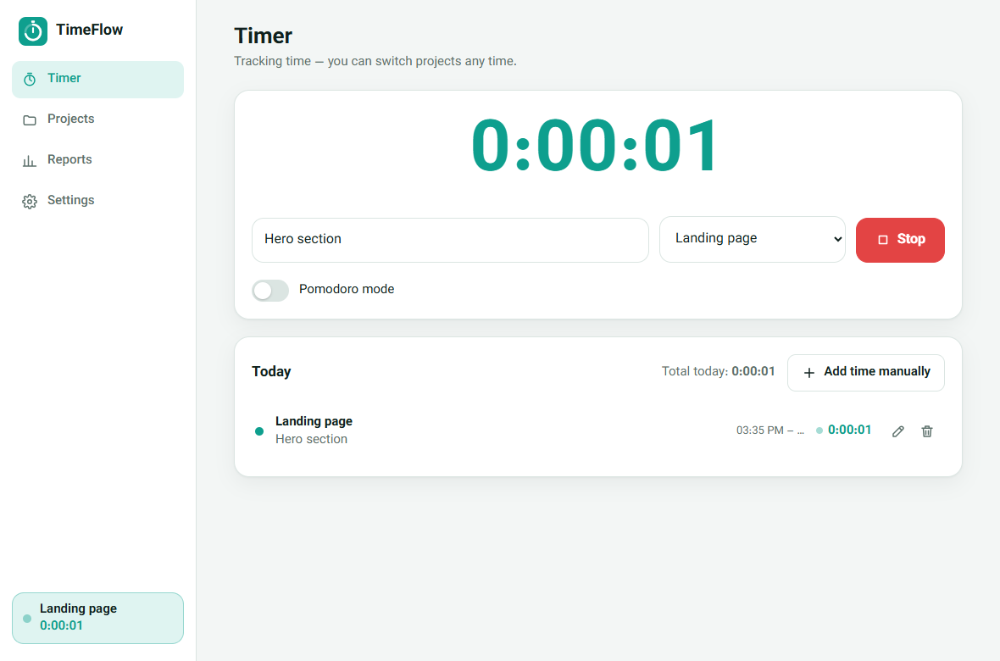
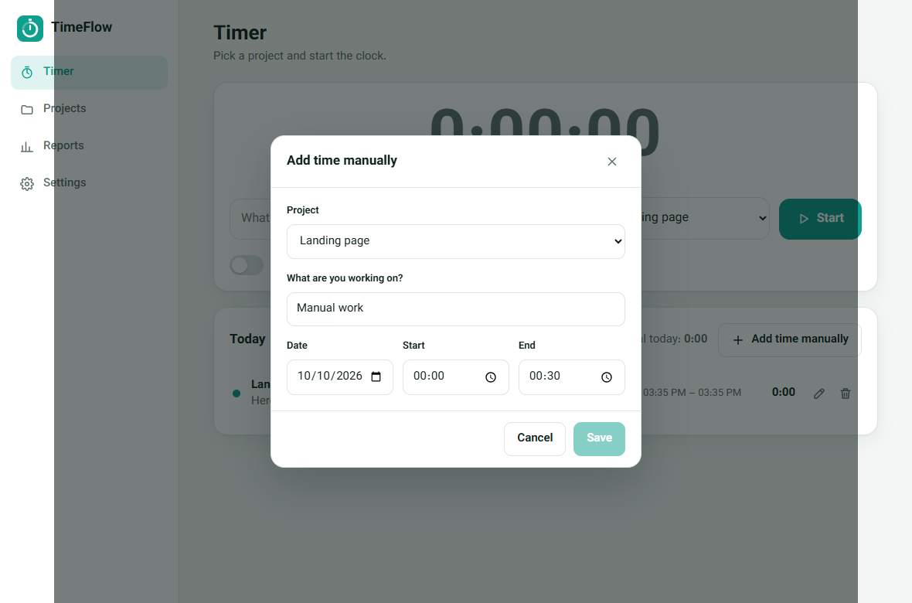
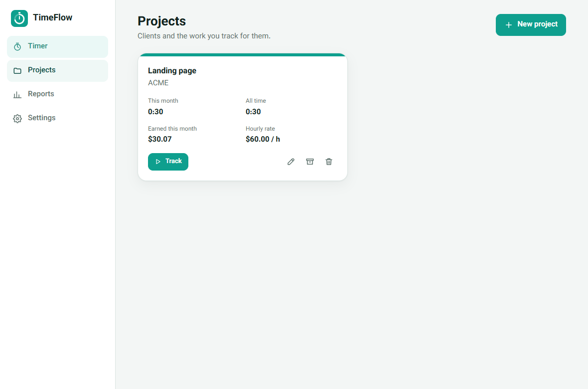
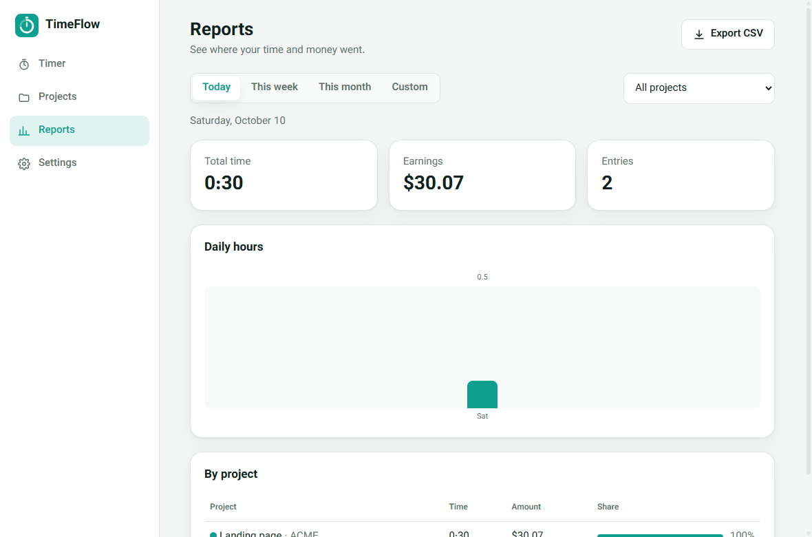
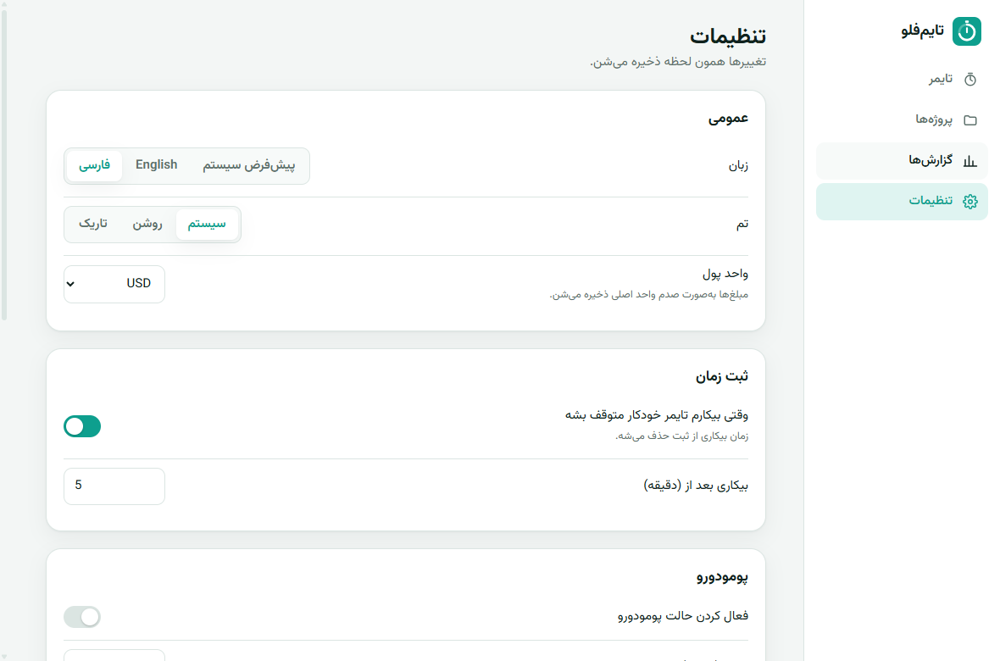
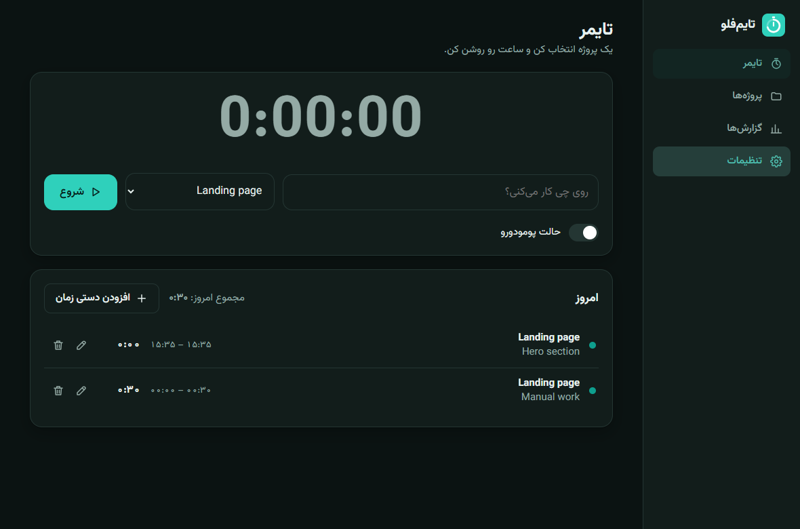
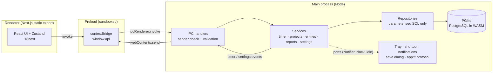
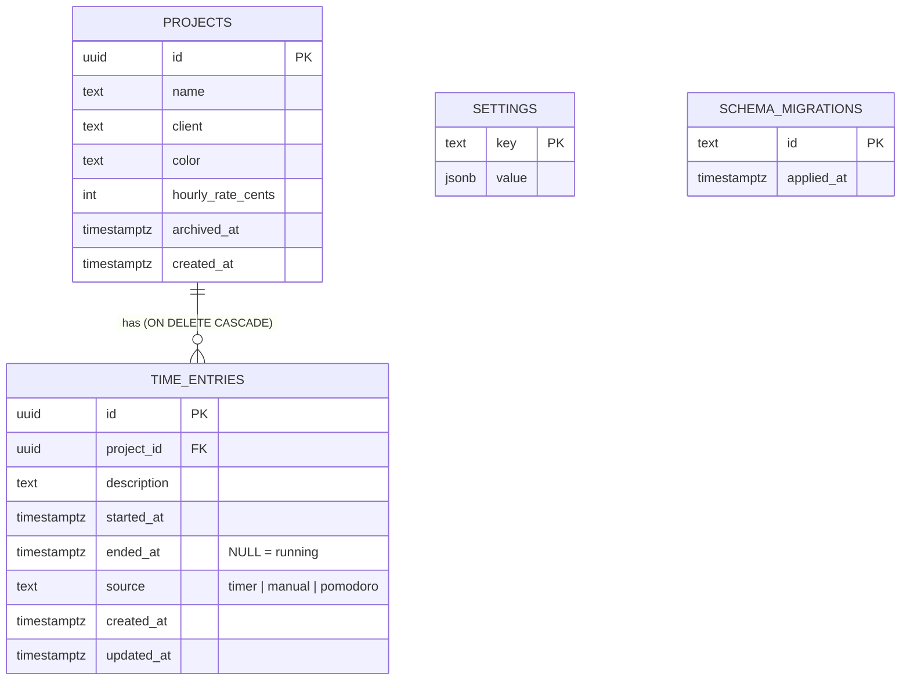

<div align="center">


# TimeFlow

**A fast, offline time tracker for freelancers — timer, projects, earnings, reports. No account, no server, no cloud.**

[](https://www.electronjs.org/)
[-000000?logo=nextdotjs&logoColor=white)](https://nextjs.org/)
[](https://react.dev/)
[](https://www.typescriptlang.org/)
[-4169E1?logo=postgresql&logoColor=white)](https://pglite.dev/)
[-26A69A?logo=i18next&logoColor=white)](https://www.i18next.com/)
[](#install-notes)

</div>

---

## About

I built TimeFlow because most time trackers want an account, a subscription, or a browser tab you can forget about. I wanted something I could open, hit **Start**, and trust — with my data sitting on my own disk in a real database.

TimeFlow is a desktop app (Electron) whose UI is a **statically exported Next.js** app. All the data lives in an **embedded PostgreSQL** (PGlite — real Postgres compiled to WebAssembly, running inside the app). Nothing to install besides the app itself, no network port is ever opened, and nothing leaves your machine.

It is fully bilingual: **English and Persian**, with a real right-to-left layout that switches instantly, and it follows your OS language by default.

> **Desktop only.** Electron covers Windows, macOS and Linux. TimeFlow does not run on Android, iOS or tablets.

## Download

Grab the latest installer from the **[Releases page](https://github.com/narko-kh/Timeflow/releases/latest)**:

| OS | File |
| --- | --- |
| Windows (x64) | `TimeFlow-<version>-win-x64.exe` |
| macOS (Intel / Apple Silicon) | `TimeFlow-<version>-mac-x64.dmg` / `TimeFlow-<version>-mac-arm64.dmg` |
| Linux (x64) | `TimeFlow-<version>-linux-x64.AppImage` / `.deb` |

The installers are not code-signed, so your OS will warn you on first launch — see [Install notes](#install-notes) for how to get past it.

## Screenshots

| Timer | Today's entries |
| --- | --- |
|  |  |
| **Projects** | **Reports** |
|  |  |
| **Persian / RTL settings** | **Dark theme, Persian** |
|  |  |

## Features

| Area | What you get |
| --- | --- |
| **Timer** | One active timer at a time, switch projects mid-run, the clock is computed from `startedAt` so it never drifts |
| **Projects** | Colors, client, per-project **hourly rate**, archive / restore, delete (with confirmation), "this month" stats |
| **Earnings** | `round(seconds × rate / 3600)` per project, stored as integer cents |
| **Idle detection** | Stops the timer after N idle minutes and **removes the idle time** from the entry |
| **Pomodoro** | 25 / 5 / 15 minutes, long break every 4 sessions (all configurable), exact-moment entry closing, skip break |
| **Reports** | Today / week / month / custom range, project filter, summary cards, daily bar chart, per-project table |
| **CSV export** | Translated headers, UTF-8 BOM, CRLF, protection against CSV/formula injection |
| **Tray + shortcut** | Tray menu with the last project, tooltip with live time, global `Ctrl/Cmd+Alt+T` to start/stop |
| **Crash recovery** | A heartbeat every 30 s; after a crash the entry is closed at the last heartbeat and you are told |
| **Languages** | English + Persian (i18next), OS language by default, instant switch, RTL layout, Persian digits |
| **Themes** | System / light / dark, explicit `data-theme` (not just `prefers-color-scheme`) |
| **Security** | Sandboxed renderer, context isolation, strict CSP, validated IPC, parameterised SQL |

## Architecture



Services never import Electron: the clock, idle provider, notifier and file saver are injected, so the whole business logic is tested with a fake clock against a real in-memory Postgres.

## Data model



A partial unique index (`one_active_entry`) guarantees that **at most one** entry can be running, enforced by the database itself.

## Tech stack

- **Electron 44** — main / preload / renderer split, custom `app://` protocol
- **Next.js 16** (App Router, `output: 'export'`) + **React 19** + **Zustand**
- **TypeScript** in strict mode, shared `@shared/*` alias for Next, tsup and Vitest
- **PGlite** (`@electric-sql/pglite`) — embedded PostgreSQL, no native modules
- **i18next / react-i18next** — one translation source shared by renderer and main
- **tsup** (esbuild) for main + preload, **electron-builder** for installers
- **Vitest** (real PGlite in memory) and **Playwright** (`_electron.launch`) for tests

## Getting started

Prerequisites: **Node.js 22+** and **Git**. There are no native modules, so you do **not** need Visual Studio, Xcode or a compiler toolchain.

```bash
git clone https://github.com/narko-kh/Timeflow.git
cd Timeflow
npm ci
npm run dev
```

`npm run dev` starts `next dev` on port 3000, bundles the Electron main/preload with tsup and opens the app pointing at the dev server.

> npm 11.19+ asks you to approve dependency install scripts. This repository already lists the approved ones under `allowScripts` in `package.json`. If Electron's binary is missing after install, run `node node_modules/electron/install.js`.

## Scripts

| Script | What it does |
| --- | --- |
| `npm run dev` | Next dev server + Electron (hot reload for the UI) |
| `npm run build` | Static export of the UI (+ CSP hashes) and the Electron bundles |
| `npm start` | Run the built app (`electron .`) |
| `npm run typecheck` | `tsc --noEmit` (strict) |
| `npm test` | Vitest unit + service tests |
| `npm run e2e` | Playwright smoke test against the built app |
| `npm run icons` | Regenerate app / tray icons from SVG with sharp |
| `npm run dist` | Build + installer for the current OS |
| `npm run dist:win` / `dist:mac` / `dist:linux` | Installer for a specific OS |

## Tests

```bash
npm test          # 87 tests: validation, reports, CSV, Pomodoro, services on real Postgres
npm run build && npm run e2e
```

- **Unit / service tests (Vitest):** validation, report building (midnight splitting, active entry, empty days), local week starts, CSV escaping and formula guard, Pomodoro state machine, migrations idempotency, timer rules, crash recovery, idle trimming, archived / running project handling, settings persistence, path-traversal guard, CSP, IPC sender check.
- **End-to-end smoke test (Playwright):** launches the real app, creates a project, runs the timer, adds a manual entry, opens reports, switches to Persian (RTL) and dark theme, relaunches to check persistence, and asserts the page has no access to `require`, `process` or `ipcRenderer` and produces no CSP violations. On a headless Linux box run it as `xvfb-run -a npm run e2e`. To test an installed build: `TIMEFLOW_EXECUTABLE=/path/to/TimeFlow npm run e2e`.

## Building installers

### With GitHub Actions (recommended)

`.github/workflows/release.yml` builds on `ubuntu-latest`, `windows-latest` and `macos-latest`, runs typecheck + tests + build, packages with electron-builder and uploads the installers as artifacts. Pushing a tag attaches them to a GitHub Release:

```bash
git tag v1.0.0
git push origin v1.0.0
```

### Locally

```bash
npm run dist:win     # NSIS installer (.exe)  — run on Windows
npm run dist:mac     # DMG (x64 + arm64)      — run on macOS
npm run dist:linux   # AppImage + deb         — run on Linux
```

Installers land in `release/`. Build each OS on its own OS (or let CI do it).

## Install notes

The installers are **not code-signed**, so each OS will warn you the first time.

| OS | Installer | First run |
| --- | --- | --- |
| **Windows** | `TimeFlow-<ver>-win-x64.exe` (NSIS, choose install folder) | SmartScreen: **More info → Run anyway** |
| **macOS** | `TimeFlow-<ver>-mac-x64.dmg` / `-arm64.dmg` | Right-click the app → **Open**, or `xattr -dr com.apple.quarantine /Applications/TimeFlow.app` |
| **Linux** | `TimeFlow-<ver>-linux-x64.AppImage` / `.deb` | `chmod +x TimeFlow-*.AppImage && ./TimeFlow-*.AppImage`. On Ubuntu 24.04+ the AppImage may need `--no-sandbox` because of AppArmor's unprivileged user-namespace restriction; the `.deb` does not have this problem. |

## Where your data lives

| OS | Folder |
| --- | --- |
| Windows | `%APPDATA%\TimeFlow` |
| macOS | `~/Library/Application Support/TimeFlow` |
| Linux | `~/.config/TimeFlow` |

The database is the `database/` folder inside it. **Backup:** quit TimeFlow and copy that folder. **Reset:** quit TimeFlow and delete it.

## Security

- `contextIsolation: true`, `sandbox: true`, `nodeIntegration: false`, `webSecurity: true`, webviews blocked.
- The renderer has **no** access to Node, files or `ipcRenderer`; the preload exposes only named functions.
- Strict CSP on the custom `app://` protocol (`default-src 'self'`, `object-src 'none'`, `base-uri 'none'`, `form-action 'none'`, `connect-src 'self'`). Inline scripts of the static export are allowed by **sha256 hash** computed at build time (`scripts/csp-hashes.mjs`). `style-src` keeps `'unsafe-inline'` because React emits `style` attributes — it does not allow script execution.
- Every IPC handler checks the sender URL and validates its input; errors are returned as codes, never internal details.
- All SQL is parameterised; dynamic `UPDATE` column names come from fixed allow-lists.
- New windows are denied (only `https:` links open in the system browser), navigation away from the app is blocked, and all permission requests are refused.
- Dependency audit: `npm audit --omit=dev` reports **0** vulnerabilities for runtime dependencies. The remaining advisories are in the build tooling (electron-builder chain, esbuild's dev server) and do not ship in the app.

## Project structure

```
src/shared/            pure types, validation, reports, CSV, Pomodoro, translations
electron/main/
  db/                  PGlite client + migrations
  repositories/        SQL only
  services/            business rules (timer, projects, entries, reports, settings)
  platform/            tray, shortcut, notifications, save dialog, menu, app:// protocol
  ipc/                 IPC handlers with sender check + validation
  window.ts            secure BrowserWindow
  index.ts             composition root
electron/preload/      window.api bridge
src/app/               Next App Router pages (/, /projects, /reports, /settings)
src/components/        UI components
src/stores/            Zustand store
src/i18n, src/lib/     client i18next, Intl helpers
tests/                 Vitest
e2e/                   Playwright smoke test
scripts/               CSP hashes, icon generation, clean
```

## Design decisions

- **Static Next export + `app://` protocol.** There is no Node server in a desktop app, so Next is exported to plain files. `file://` breaks `/_next/...` absolute paths, so a privileged custom scheme serves the export, guards against path traversal and attaches the CSP and security headers to every response.
- **PGlite instead of "install PostgreSQL".** Users get real SQL, transactions, partial unique indexes and migrations without installing or configuring anything, and with no native module the cross-platform build stays trivial. It is single-connection and only the main process touches it.
- **Heartbeat for crash recovery.** A crash can't run code, so the app writes a timestamp every 30 s while a timer runs. On the next start, if the gap is larger than 2 minutes the running entry is closed at the last heartbeat — you lose at most 30 seconds, not hours.
- **Idle detection trims, not just stops.** Stopping at "now" would still bill the idle time; the entry is closed at `now − idle`.
- **CSV injection guard.** A project or description starting with `= + - @` could execute as a spreadsheet formula, so such cells are prefixed with `'`.
- **Explicit theme.** `prefers-color-scheme` alone can't express "always light" or "always dark" inside an app setting, so the theme is a `data-theme` attribute on `<html>`, mirrored to `nativeTheme.themeSource`.
- **Money as integer cents.** No floating-point drift in earnings; formatting is done with `Intl` at the edge.
- **Reports use local days.** Entries are clipped to the range and split at local midnight, so a night session is counted on the right days. The functions are pure and tested with local dates, independent of the machine's time zone.

## Limitations

- Installers are **unsigned** (see install notes). No auto-update.
- Idle detection, the global shortcut and the tray depend on the OS / desktop environment (for example Wayland restricts global shortcuts and idle time, and GNOME needs an extension for tray icons).
- Persian mode shows the Solar Hijri calendar in labels; the native date pickers follow the OS locale.
- Data is local only: no sync, no multi-device, no import.
- Desktop only (no mobile or tablet builds).
- macOS and Linux installers are built by CI; I could only run the packaged app on Windows locally.

## Roadmap

- Code signing and notarization, auto-update
- Tags and billable / non-billable flag
- PDF invoices from a report
- Keyboard-only quick-switcher for projects
- Optional encrypted backup / restore

## Author

Built by **Mobin Khastehband** (Narko), full-stack developer — available for freelance work.

- GitHub: [@narko-kh](https://github.com/narko-kh)
- Email: narkokh022@gmail.com

Released under the MIT License.
